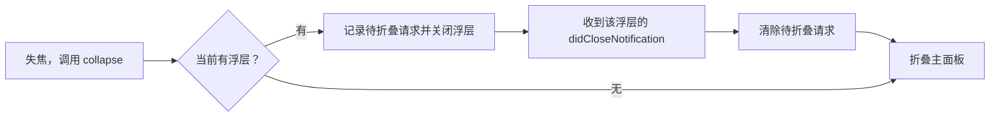

# 2026-11-10：设置失焦后，灵动岛折叠跳位

状态：用户复验确认问题消失。复现场景为 macOS 内置刘海屏，使用当时工作区构建的 Codex Signal 应用。

可复用的操作步骤见 [排查手册](README.md)。本页保存这次排查的事实、误判与验证结果。

## 现象与复现条件

用户提供了稳定复现路径：

1. 点击顶部灵动岛，展开主面板。
2. 点击 **设置**，打开浮层。
3. 点击其他地方，使应用失去焦点。

主面板折叠后短暂出现在屏幕中部，随后回到顶部。用户还提供了中途跳位的截图。只检查操作结束后的窗口位置会漏掉这个问题。

## 已证实的原因

旧的 `IslandPanel.collapse()` 在失焦时立即调用 `model.setExpanded(false)`。主面板开始折叠时，设置浮层的关闭过程尚未结束，浮层窗口仍依附于主面板。

关闭设置与折叠主面板缺少完成顺序。这是本次修复针对的应用层错误。系统内部如何计算出那次具体偏移，没有被完整追踪，不能据此归因于某个 AppKit 坐标公式或动画插值实现。

以下是同一次关闭过程的诊断日志摘录。已去掉进程号、线程号和对象地址，仅保留时间与状态：

```text
14:09:04.881 NSPopoverWillCloseNotification shown=true  parent=SignalPanel
14:09:05.431 NSPopoverDidCloseNotification  shown=false parent=nil
```

关闭开始与关闭完成之间，浮层仍有父窗口。上述时间是一次观察结果，不是可以写进代码的固定等待时长。

日志原件当时位于 `/tmp/codex-signal-popover.log`。本页已保存关键摘录，后续阅读不依赖该临时文件仍然存在。

## 排查经过与无效尝试

| 阶段 | 观察或尝试 | 结论与处理 |
| --- | --- | --- |
| 检查已有位置恢复逻辑 | 主面板已能在偏移后回到目标 frame，已有测试也检查最终位置。 | 这些检查无法证明过渡过程没有跳动。 |
| 追踪窗口坐标 | 在窗口位置设置方法中加入临时日志，并检查原生窗口 frame；没有捕捉到与用户画面对应的坐标偏移。 | 只能说明这组观察没有抓到偏移。直接把系统隐式动画认定为根因，证据不足。 |
| 改为逐帧固定顶部 | 用逐帧更新替换系统窗口动画，位置相关测试通过。 | 用户明确反馈仍有同一个 bug。该方案没有解决原因，后续已完全撤掉。 |
| 验证用户提出的关闭顺序 | 用户提出先关闭设置再折叠。诊断日志确认原生关闭开始与完成是两个阶段。 | 调查转向浮层生命周期，而非继续修改动画。 |
| 核对复现输入 | 应用内另一扇窗口取得焦点时，原生浮层可能已先关闭；这条自动化路径没有暴露用户点击其他应用时的重叠。 | 改为向已有失活处理入口发送 `NSApplication.didResignActiveNotification`，检查折叠发生时浮层是否仍附着。 |
| 尝试 SwiftUI 消失回调 | 临时尝试通过绑定状态与 `onDisappear` 协调折叠。 | 在该测试路径中没有按预期完成折叠。该尝试未保留，最终使用原生关闭完成通知。 |
| 等待原生浮层关闭 | 保存当前浮层和待折叠请求，在该浮层的 `didCloseNotification` 到达后折叠。 | 顺序回归测试通过，用户随后确认问题消失。 |

最初排查的主要错误，是在尚未证明原因时替换了动画实现，并用没有覆盖失败过程的测试结果支持该判断。用户的复验推翻了这个判断。

## 最终保留的实现

修复集中在 [IslandPanel.swift](../../Sources/SignalApp/IslandPanel.swift)，沿用原来的窗口动画：



`presentedPopover` 保存属于面板的当前浮层，`collapseAfterPopover` 表示关闭完成后需要折叠。连续失焦不会重复启动关闭；其他浮层的关闭通知不会消费这个请求。Escape 也经过 `collapse()`。

最终实现没有保留逐帧动画、临时 SwiftUI 协调状态或诊断埋点，也没有增加固定等待时间。

## 回归检查及其证据

[IslandPanelTests.swift](../../Tests/SignalAppTests/IslandPanelTests.swift) 中的 `losingFocusClosesSettingsBeforeCollapsing` 打开真实设置浮层，向已有失活处理入口连续发送两次通知，并观察主面板状态变化。

测试在主面板变为收起状态时检查 `settingsWindow.parent`。若仍有父窗口，则记录 `collapsedBeforeSettingsClosed` 并使测试失败。测试还检查移动和尺寸通知期间的顶部位置、水平中心，以及最终收起后的 frame。

展开到打开设置、打开设置到失焦，两段间隔分别取 20、80、400 毫秒，共 9 种组合。设置必须实际出现，测试才继续；结束时的一秒等待仅用于测试观察，不是产品中的关闭延时。

同一顺序约束的修复前后结果为：

```text
修复前：1 个参数化测试，9 种组合均违反关闭顺序，9 个失败。
修复后：该顺序测试通过；完整运行通过 131 项 Swift 测试。
Python：27 项桥接测试、16 项关联测试、3 项安装器测试通过。
```

修复前与完整复验的日志当时分别保存于 `/tmp/codex-signal-popover-before.log` 和 `/tmp/codex-signal-popover-full.log`。以上为摘录整理，测试数量反映本次运行，不是后续版本的固定门槛。

应用重新构建启动后，进行了展开、打开设置和外部窗口失焦的原生操作。最终视觉结论包含用户明确回复“现在没有bug了”。自动测试证明关闭顺序；用户复验确认原先看到的跳动消失。

## 验证范围

本次确认的是内置刘海屏上“展开主面板、打开设置、点击外部”的路径。没有据此宣称所有外接屏、全屏空间、辅助功能设置或嵌套浮层组合均已验证。

顺序保护位于 `IslandPanel.collapse()`。修改菜单栏切换、收起按钮或提醒预览时，仍需检查它们是否直接调用 `setExpanded(false)`，并对对应路径复验。

后续另行补充了设置底部的 **退出** 入口，并验证退出后重新启动。该控件检查与窗口生命周期检查分别记录，不能用其中一个替代另一个。
